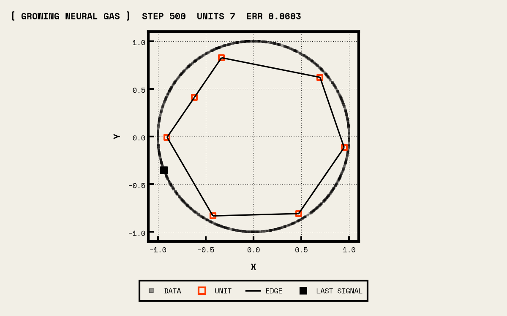
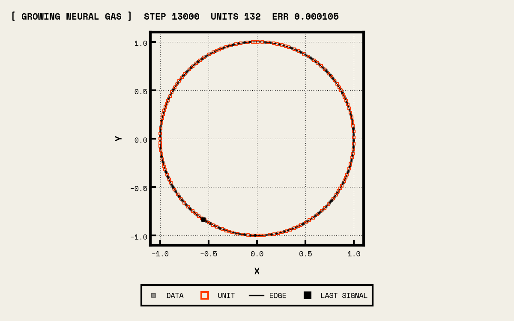
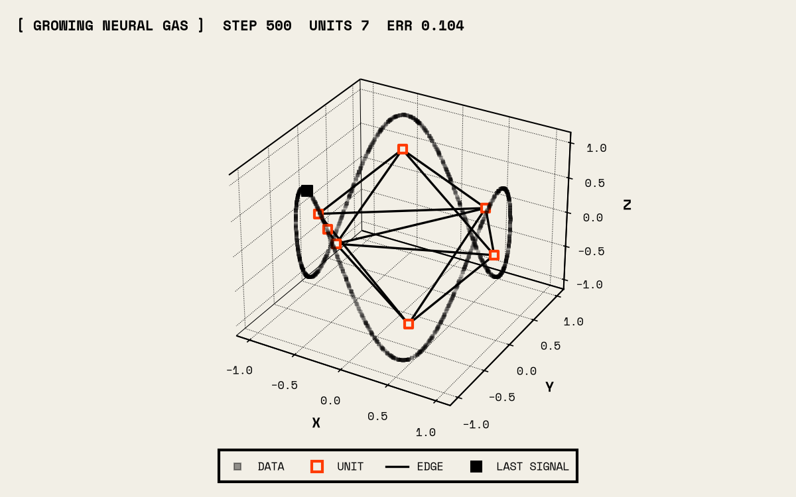
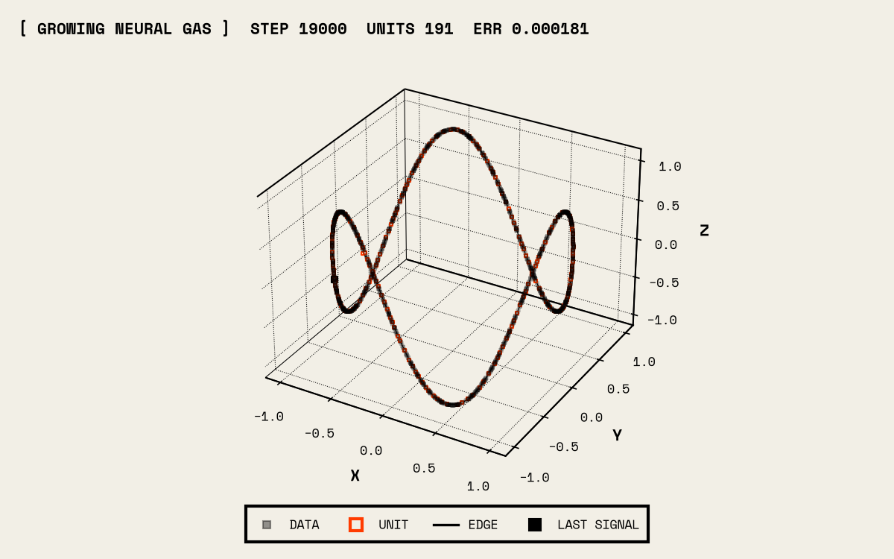
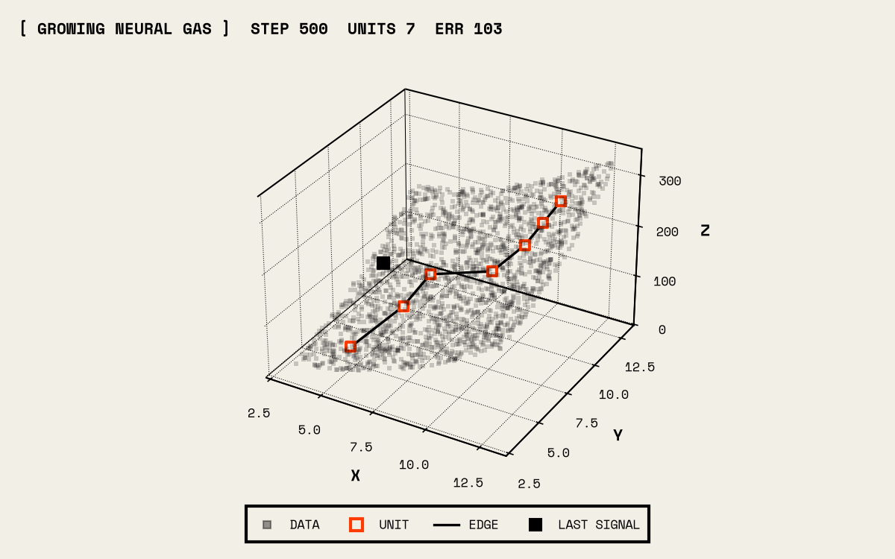
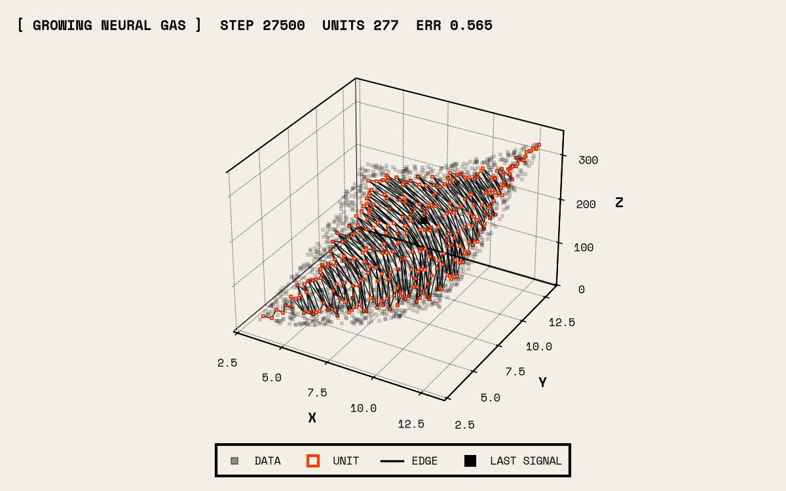

# GrowingNeuralGas
Growing Neural Gas algorithm from "A Growing Neural Gas Network Learns Topoligies" by Fritzke B. 

Example usage: 
~~~
from GNG.neuralgas import GraphNeuralGas
from example.distributions import Box, Circle, TiltedCircle, HypPar  #this is mimiking some data 

NG = GraphNeuralGas(
    distribution=HypPar(n=800),
    growing_rate=100,
    eps_b=0.2,
    eps_n=0.006,
    a_max=50,
    beta=0.995,
    alpha=0.5,
    plot_rate=500,
    figpath='./example/HypPar3d',
    gas_d=3,
    max_number=500,
    min_number=50,
    error_tolerance=1,
)
NG.evolve(steps=100000)
~~~
Examples

Circle

TwistedCircle3d

Surface3d

## Notes
The code follows the algorithm of the paper step by step (see the docstring of `GraphNeuralGas`).
Parameter names: `growing_rate` = λ, `eps_b`, `eps_n`, `alpha`, `a_max`, `beta` = d.

- `error_tolerance` is compared with `quantization_error()`, an estimate of the mean squared quantization error
  per dimension, in the units of the data. It is `(1-beta)/beta * sum(E_c) / gas_d`.
- The data are a finite point cloud that is resampled. If the units get denser than the points, some neighbouring
  units are never the two closest ones to any point and their edge dies (a ring can end up cut in arcs). Use enough points.
- Plots are drawn in the style of the blog (`GNG/style.py`). The font is Space Mono, with a monospace fallback.
- To regenerate all the pictures of `example/`: `python -m example.generate` (or `python -m example.generate Circle Box2d`).
